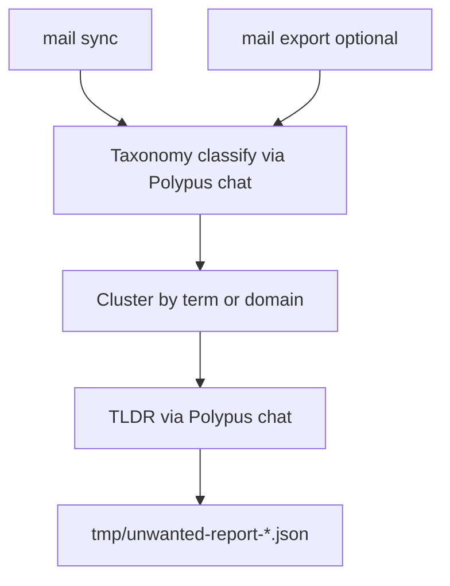

# Report-only unwanted mail evaluation

First milestone after Polypus wiring: classify and cluster unwanted mail, produce TLDRs, **do not mutate the mailbox**.

## Goal

Decide whether taxonomy-backed classification is accurate enough to justify quarantine later. Done looks like a reproducible report: per-message leaf assignments (and optional catalog aliases), then later cluster membership and short cluster summaries, with no deletes, moves, or mark-read side effects.

## Roles

| Component | Owns | Does not own |
|-----------|------|--------------|
| Host mail lane (Neverest + pimdir) | Sync, local storage, post-sync classify, mail export | Direct OpenRouter or TypeSafe calls |
| Polypus | All model HTTP (`/v1/*`), allow-lists, breakers | Mailbox semantics |
| Taxonomy harness (host seats) | Walk: Judge + Author on `inbox-mail`. Attach: Essence + embed + optional Walk reinforce on `inbox-kind` | Mailbox mutation |
| Chat/summary model (via Polypus) | Cluster TLDR text (`polypus.tldr_model` or `classify_model`) | Per-message leaf assignment |

## Pipeline (report only)



1. Sync mail with `go tool task mail:sync`. After a successful fetch, the host classifies newly fetched unique messages (cap per `taxonomy.classify_max`; use `--no-classify` to skip). Polypus down after sync: replica stays; classify skipped; exit 0.
2. Resume or backfill with `go tool task mail:report` / `should-i-read mail report` (lists recent pimdir rows, reads `--in` export JSON, or selects a UTC date window). Requires Polypus up (fail closed) and a SystemOne judge resolved via `polypus check --classify` or successful in-process discovery.
   - **Date window:** `--from` and `--to` as `YYYY-MM-DD` (UTC midnight), half-open `[from, to)`. Filters live pimdir rows by `items.sort_key` within `taxonomy.collections`. No row cap unless you set `--limit`. Cannot combine with `--in`.
   - **Hop cap:** `taxonomy.classify_max` limits new Operate and attention calls per run. Rerun the same `--from`/`--to` while `omitted` or `attention_omitted` is non-zero.
   - **Example (September 2026, one week each):** `go tool task mail:report -- --from 2026-09-01 --to 2026-09-08`, then `2026-09-08`/`2026-09-15`, `2026-09-15`/`2026-09-22`, `2026-09-22`/`2026-10-01`. Day `2026-09-08` belongs only to the second window.
   - **Artifacts:** each run writes `tmp/unwanted-report-<ts>.json` with optional `window_from` / `window_to`. Per-message ledger rows accumulate by `object_hash`. The live cluster cache is overwritten for each `cluster_id` on the latest processed window (weekly JSON files are the snapshots).
3. For each message, taxonomy `Operate` runs **walk** (default) or **attach** (`taxonomy.strategy: attach`). Walk: Judge SystemOne noul per sibling at each hop, then optional Author + gate via Polypus chat. Attach: Essence is three Polypus chat hops (WHY slave, TAGS slave, KIND slave), then embeddings, cosine alias or Walk reinforce or breadcrumb create on `inbox-kind`. Report rows include `path`, and attach rows add `kind`, `about`, `shape`, `cosine` (leaf attach match), `description_cosine` (email vs ABOUT when `taxonomy.description_cosine_mode` is `report` or `repair`), `canonical_term_id`, `reinforced`. Breadcrumb ABOUT/SHAPE must pass host layout/length gates before catalog apply. Accepted drafts update the active catalog YAML unless `--no-apply`.
4. Cluster messages in the report by `canonical_term_id` / `term_id`, then sender domain; optional embedding attach via `cluster.min_cosine`. One TLDR per cluster via Polypus chat (cached in host SQLite by fingerprint).
5. Write `tmp/unwanted-report-<timestamp>.json` with `cluster_id` on each message and `clusters[]` summaries. **No mailbox trash/spam/delete API calls.**

## Output schema (minimum)

```json
{
  "mode": "report_only",
  "polypus_base_url": "http://127.0.0.1:1320",
  "messages": [
    {
      "id": "…",
      "cluster_id": "c1",
      "decisions": {
        "is_unwanted": 0.97,
        "category": "newsletter",
        "urgency": 0.1
      }
    }
  ],
  "clusters": [
    {
      "id": "c1",
      "size": 12,
      "tldr": "Weekly retail promos from the same ESP.",
      "suggested_action": "quarantine_candidate"
    }
  ]
}
```

## Thresholds (draft; tune after first run)

| Gate | Draft rule | Effect |
|------|------------|--------|
| Auto-flag for review | `is_unwanted >= 0.90` and `category ∈ {spam, phishing, newsletter, promo}` | Appears in report only |
| Hold for human | `0.70 <= is_unwanted < 0.90` | Separate "uncertain" section |
| Leave alone | `is_unwanted < 0.70` or `category = legitimate` | Omitted from unwanted clusters |
| Quarantine automation | Not allowed in this milestone | Requires explicit later approval |
| Permanent delete | Never in v1 | Out of scope |

## Explicit non-goals

- Moving messages to Spam or Trash
- Permanent deletion
- Marking messages read
- Training on full mailbox without a sampled window
- Calling TypeSafe / Jev without Polypus

## Exit criteria to unlock quarantine later

- Evaluation set of at least 100 labeled messages (human-checked)
- Precision on `is_unwanted` for the auto-flag band meets an agreed target (set after first report)
- Zero false-positive phishing misses on the eval set for the auto-flag band, or documented accepted risk
- Operator can reproduce the report from CLI with Polypus up and mail synced

## Shipped slice (taxonomy v0.3.0+)

- Post-sync classify on fetch hunks; `mail report` for resume/backfill.
- INBOX (or `taxonomy.collections`) item pick, then taxonomy `Operate` per message (walk on `inbox-mail`, attach on `inbox-kind`).
- `taxonomy.strategy`: `attach` (default; legacy `walk` is normalized to attach). Requires `polypus.embed_model` and Essence chat (`polypus.essence_model` or classify author); Operate timeout is `operateTimeoutAttach` (5 minutes). Thresholds: `attach_min_cosine` (0.80), `walk_reinforce_min` (0.70).
- `taxonomy.classify_max` caps Operate (Polypus) calls per run.
- `taxonomy.author_on_skip: false` (default) skips Author chat on Judge skip; set `true` to restore draft proposals. When Author runs, the host cleans the latest body (reply parser + line denoise + extractive cap) before Granite sees it.
- Strop `JobRunner` generator `mail_classify` wraps taxonomy `Operate`; Polypus HTTP only inside Judge/Author/Essence/Embed seats.
- Artifacts: `tmp/unwanted-report-*.json` (snapshot) with `clusters[]`, per-message `cluster_id`, `suggested_action` (`review` or `quarantine_candidate` when `cluster.quarantine_terms` matches), and nested `attention` on messages and clusters (`urgency`, `needs_reply`, `involves_decision` from Jev SystemOne via Polypus; report-only). When Essence parse fails after retries, the last chat completion is written to `tmp/essence-parse/<object_hash>.json` (`essence_dump_dir` on the report). Live classify state, embeddings, attention nouls, and cluster TLDR cache: host SQLite (`store.path`; tables `classify_state`, `embeddings`, `clusters`, `cluster_members`). `tmp/mail-classify-progress.json` is import-only when the ledger is empty.
- Config: `cluster.min_cosine`, `cluster.quarantine_terms`, `cluster.attention_true_min` (default 0.50), optional `polypus.tldr_model`.

## Essence benchmark (frozen input)

Operator classify uses the **checklist** repair contract by default (high-effort Essence escalation plus the silent validation checklist on ABOUT rewind). Bench `baseline` and `thinking` only exist as ablations (`SHOULD_I_READ_BENCH_*`); iterate prompt copy against **checklist**, then compare ablations if needed.

Compare Essence prompt variants on the **same** 100 messages (live Polypus, report-only, fresh ledger per chunk):

1. `go tool task mail:export -- --limit 500 --out bench/input-export.json` (needs at least 100 unique `object_hash` values).
2. `./bin/should-i-read mail bench freeze --in bench/input-export.json` writes `bench/input-100.json`, `bench/chunks/c1.json`…`c5.json`, and `bench/input-rev.txt`. Use `--out-dir bench/eval-100` for a dated freeze that does not overwrite an older dump.
3. Edit `bench/labels-20.json` (`expected_leaf`, `required_terms`) after `mail bench labels-stub` if needed. Follow **Last-slot gold** below. Committed smoke labels live in `testdata/bench/labels.json` (revision in `input-rev.txt`).
4. `go tool task polypus-check -- --classify`, then smoke the production-like variant on committed fixtures (no live pimdir): `./bin/should-i-read mail bench --fresh --variant checklist --chunks testdata/bench/chunks --labels testdata/bench/labels.json --input-rev testdata/bench/input-rev.txt`.
5. Full matrix (sequential, live freeze under gitignored `bench/`): run each variant with `--fresh` so the classify ledger under `tmp/bench/<variant>/` is wiped first (otherwise bench reuses cached classifies and wall time is misleading). Example: `./bin/should-i-read mail bench --fresh --variant baseline --chunks bench/chunks` → `tmp/bench/<variant>-artifact.json` and `tmp/bench/<variant>-score.json`. Or `go tool task mail:bench-matrix` for baseline, thinking, and checklist on `testdata/bench` fixtures.

### Last-slot gold

`expected_leaf` is the **last segment of Essence `KIND`** (`family > class > leaf`). It is the catalog leaf, not a free-form category and not the parent stuffed into the leaf. Bench `leaf_accuracy` compares only that last segment.

KIND is a three-level tree. Put the distinctive word in **one** slot. If class (or family) is already `security`, `meeting`, `event`, or `ci`, the leaf stays the short event type (`alert`, `reminder`, `webinar`, `pull-request`). Hyphenating the parent into the leaf (`security-alert`, `meeting-reminder`, `webinar-invitation`, `pull-request-comment`) fails last-slot score against a legal tree, and `security > … > security-alert` is rejected as a parent-prefix repeat.

| Mail | KIND last slot (gold) | Do not use as gold |
|------|----------------------|--------------------|
| LinkedIn “just messaged you” digest | `message` | `new-message` |
| Google or broker security notice | `alert` under a `security` parent | `security-alert` |
| Calendar reminder | `reminder` | `meeting-reminder` |
| Webinar invite | `webinar` | `webinar-invitation` |
| GitHub Actions run failed | `workflow-failure` | `failure`, `ci-failure` |
| Bot comment on a pull request | `pull-request` | `pull-request-comment`, `workflow-failure` (even if the comment reports a quality gate) |
| Published newsletter post | `article` | `personal-communication` as the leaf |
| Confirm tax residency / similar account confirm | `confirmation-request` | `tax-residency-confirmation` |
| Sub-processor or support tooling change | `update` | `processor-change` |

Do not copy a unique ABOUT detail into `expected_leaf`. Distinguishing phishing from a Google sign-in lives in the **parent path**, not in two different last-slot names, unless the events are truly different reusable types (for example `workflow-failure` vs `pipeline-failure`).

Bench-only env (unset in normal classify): `SHOULD_I_READ_BENCH_REASONING` (`high`|`off`), `SHOULD_I_READ_BENCH_FEEDBACK` (`checklist`|`short`). Variants: baseline (`off`+`short`), thinking (`high`+`short`), checklist (`high`+`checklist`). Each chunk probes Essence (`polypus.essence_model`) and does not smoke Author (`polypus.classify_model`) or embeddings (`polypus.embed_model`). Operator classify still fail-closes on those probes. Gateway is `polypus.base_url` / `POLYPUS_BASE_URL` (homelab: `https://polypus.manticore-powan.ts.net`).

## Next implementation slice

1. Tune eval thresholds and `is_unwanted` scoring against labeled samples (aspirational `decisions` block in the schema below).
2. Reversible quarantine automation only after exit criteria pass (still no permanent delete in v1).
